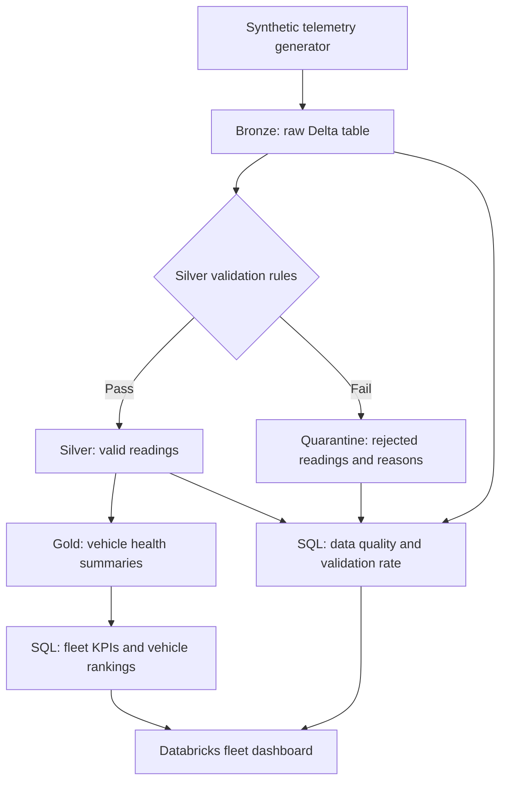
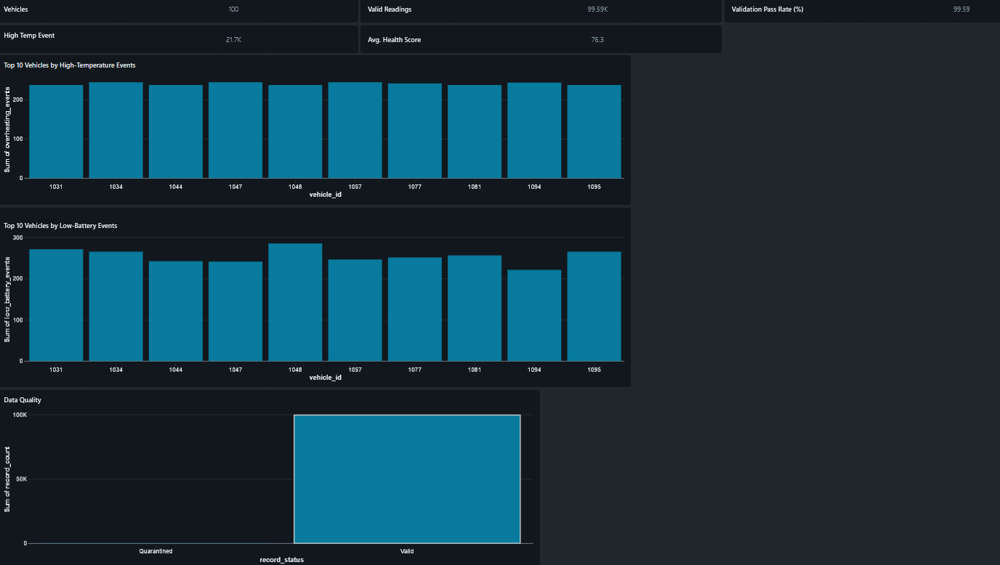
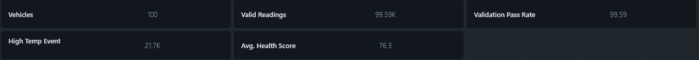
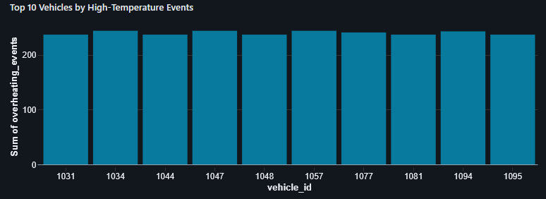
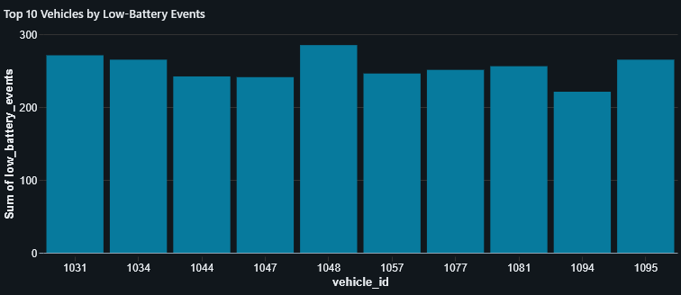
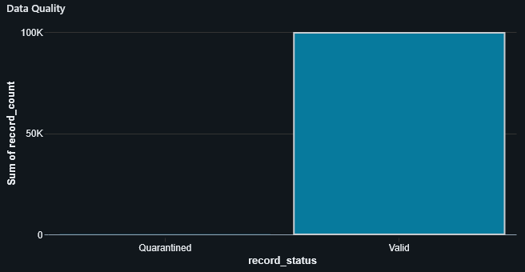

# Vehicle Telemetry Data Engineering Pipeline

**Python · PySpark · Databricks Free Edition · Delta Lake · SQL**

A batch data engineering project that generates synthetic vehicle telemetry and processes it through Bronze, Silver, and Gold Delta tables. The pipeline retains raw readings, separates valid and rejected records, reconciles row counts, and builds vehicle-level summaries for a fleet dashboard.

Built in Databricks Free Edition. All telemetry is synthetic; the diagnostic thresholds and health score are illustrative.

## Explore the project

| Area | Contents |
|---|---|
| [Notebooks](notebooks/) | Three ordered pipeline notebooks, with outputs cleared |
| [Python source](src/) | Matching Databricks source-format notebooks for code review |
| [Dashboard SQL](sql/README.md) | Five datasets and chart configuration guidance |
| [Data model](docs/data-model.md) | Table grain, columns, validation rules, and score definition |
| [Screenshots](screenshots/) | Original saved dashboard views |

## Architecture



The diagram uses GitHub's supported [Mermaid code-block format](https://docs.github.com/en/get-started/writing-on-github/working-with-advanced-formatting/creating-diagrams).

### Bronze — generate and retain raw telemetry

[`02_Generate_Vehicle_Data`](src/02_Generate_Vehicle_Data.py) creates **100,000 readings** across **100 vehicles**, with 1,000 one-minute observations per vehicle starting October 1, 2026. Each reading contains a vehicle ID, timestamp, engine temperature (°C), auxiliary battery voltage (V), and speed (km/h).

The generator deliberately introduces missing temperatures, negative speeds, and zero battery voltages. It adds an ingestion timestamp and writes `vehicle_telemetry.bronze_telemetry` in Delta format.

### Silver — validate and quarantine

[`03_Clean_Vehicle_Data`](src/03_Clean_Vehicle_Data.py) checks required identifiers and timestamps, temperature bounds, battery voltage bounds, and speed bounds. It writes accepted rows to `vehicle_telemetry.silver_telemetry` and rejected rows, including all applicable failure reasons, to `vehicle_telemetry.quarantine_telemetry`.

A saved-table row-count assertion checks that **Bronze = Silver + Quarantine**. A row that violates multiple rules is quarantined once.

### Gold — summarize vehicle health

[`04_Vehicle_Health_Analytics`](src/04_Vehicle_Health_Analytics.py) flags valid readings with engine temperature **>105°C** or battery voltage **<11.8 V**. It aggregates counts, averages, and event rates by vehicle, then writes `vehicle_telemetry.gold_vehicle_health`.

```text
health_score = round(max(0, 100 - 60 × overheating_rate - 40 × low_battery_rate), 1)
```

Rates are fractions from 0 to 1. Risk bands use the rounded score: **High** below 70, **Moderate** from 70 to below 85, and **Low** at 85 or above. An event means one flagged reading, not a distinct mechanical failure. A reading can trigger both flags.

Assertions check for 100 vehicle summaries and verify that summed Gold reading counts equal the Silver row count.

## Dataset size and recorded results

The exact row counts below follow from the generator's fixed record IDs and fault-injection rules. Dashboard values retain the precision visible in the saved screenshots.

| Metric | Value | Evidence |
|---|---:|---|
| Generated readings | 100,000 | `spark.range(100000)` |
| Simulated vehicles | 100 | Vehicle IDs 1001–1100 |
| Expected valid readings | 99,587 | Generator and Silver rules |
| Expected quarantined readings | 413 | Unique IDs divisible by 499, 997, or 887, including ID 0 |
| Expected validation pass rate | 99.587% | 99,587 / 100,000 × 100 |
| Vehicle summaries shown | 100 | Saved dashboard |
| High-temperature readings shown | 21.7K | Saved dashboard; rounded display |
| Mean vehicle health score shown | 76.3 | Saved dashboard; rounded display |

The supplied notebooks contain no execution outputs. Screenshots show 99.59K valid readings and a 99.59% pass rate; they do not establish more precise event totals. Random seeds are specified, but sensor values and event counts can vary with Spark partitioning or execution plans. These are dataset statistics, not performance benchmarks or diagnostic accuracy measurements.

## Dashboard



### Fleet KPIs



### High-temperature readings



### Low-battery readings



**Screenshot limitation:** The saved battery chart shows the same ten vehicle IDs as the temperature chart. Its “Top 10” title does not establish an independent fleet-wide battery ranking. To build that ranking, use [`05_battery_health.sql`](sql/05_battery_health.sql), which selects vehicles by low-battery count. The original screenshots are retained as captured.

### Data quality



See the [SQL dataset guide](sql/README.md) for chart mappings and metric definitions. The screenshots are static evidence; a dashboard configuration export is not included.

## Run the pipeline

1. Use a Databricks workspace with Python notebook execution, Delta support, and permission to create a schema and tables in the selected catalog.
2. Import the three files in [`notebooks/`](notebooks/), or use the matching `.py` files in [`src/`](src/). Choose one format. The Python files use Databricks' [source header and cell separators](https://docs.databricks.com/aws/en/notebooks/notebook-export-import).
3. Run each notebook from top to bottom in this order:

   | Order | Notebook | Writes |
   |---|---|---|
   | 1 | `02_Generate_Vehicle_Data` | Bronze |
   | 2 | `03_Clean_Vehicle_Data` | Silver and Quarantine |
   | 3 | `04_Vehicle_Health_Analytics` | Gold |

   The original numbering is retained; no `01` notebook is required.

4. Keep the same current catalog across notebooks and the SQL editor. All table references use the two-part name `vehicle_telemetry.table_name`.
5. After all three notebooks finish successfully, run the queries in [`sql/`](sql/) and configure dashboard visuals using the [dataset guide](sql/README.md).

**Rerun behavior:** Writes use `mode("overwrite")`, replacing existing contents of the four project tables. Run the complete sequence before refreshing the dashboard so that all tables represent the same batch. Writes to separate tables are not an atomic pipeline transaction.

The Databricks runtime supplies `spark`, `display`, PySpark, and Delta support. These files are notebooks, not standalone local Python applications. Keep the code cells in `notebooks/` and the corresponding `src/` exports synchronized when editing.

## Scope and limitations

- This is a synthetic batch demonstration. It does not implement live streaming, incremental ingestion, upserts, deduplication, or automated scheduling.
- Every vehicle uses the same random distributions; the data does not model vehicle-specific faults or real driving behavior.
- The health score is a deterministic heuristic, not machine learning or a validated automotive diagnostic.
- Data-quality checks cover the generated schema and specified bounds. They are not a complete contract for arbitrary external sensor data.
- Reconciliation assertions check row counts; they do not prove record uniqueness or validate every metric. The expected vehicle count is fixed at 100.
- No Azure deployment or production infrastructure is included. There is no automated test suite or performance benchmark.

Possible extensions include parameterized batch generation, focused validation-rule tests, and vehicle-specific synthetic scenarios.

## Author

[Rish Nayak](https://github.com/Nayak0214) · Computer Science, Arizona State University
